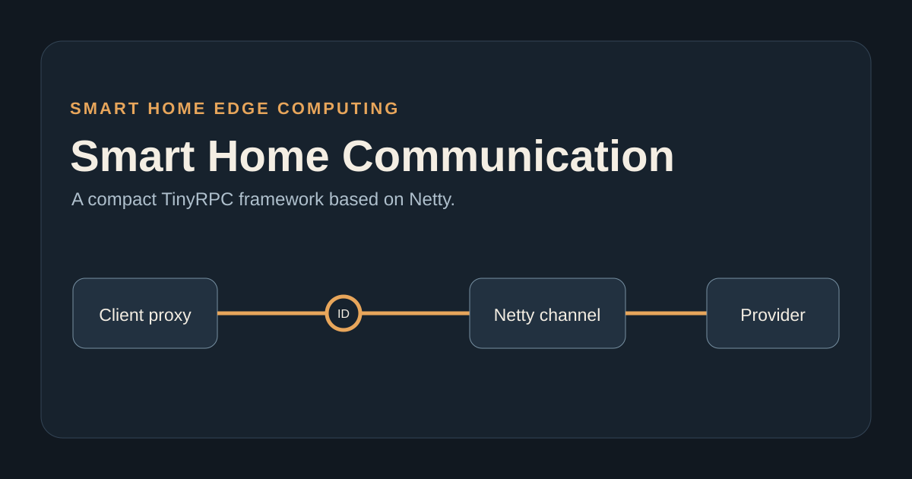
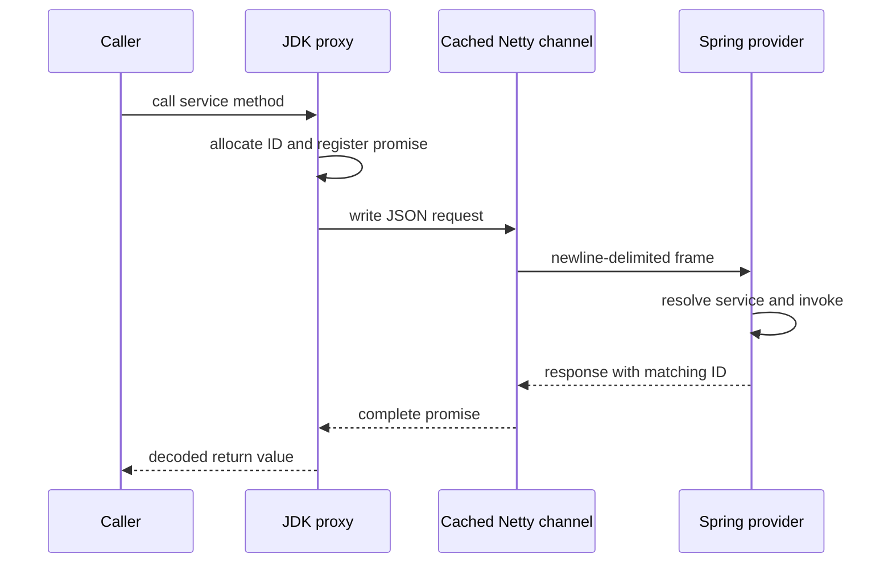

# Handwritten Netty RPC

Handwritten Netty RPC is a compact Java RPC implementation built to make the mechanics of remote invocation visible: JDK dynamic proxies create requests, Netty transports newline-delimited JSON frames, a provider resolves Spring services through reflection, and promises correlate concurrent responses.

## Request flow



The public proxy boundary is synchronous and has a five-second deadline. The client reuses a healthy channel, reconnects after it becomes inactive, and closes its event-loop group during Spring shutdown. Correlations are cleared on response, write failure, timeout, cancellation, channel close, and client shutdown.

## Run locally

Prerequisites: JDK 8 and Maven 3.6+.

```bash
mvn --batch-mode --no-transfer-progress test
mvn -pl Provider spring-boot:run
```

In another terminal:

```bash
mvn -pl Consumer spring-boot:run
curl 'http://127.0.0.1:8099/getUser?id=1001'
curl 'http://127.0.0.1:8099/getUsers'
```

The consumer connects to `127.0.0.1:8123`, so the demo does not contact an external service.

## Test coverage

```bash
mvn --batch-mode --no-transfer-progress test
```

The tests include an actual Netty provider on an ephemeral loopback port. They cover rapid responses, 24 concurrent distinct calls over the cached channel, exact `RuleSpec` JSON-string transport, unknown and duplicate replies, timeout and disconnect cleanup, and event-loop shutdown.

Run only this verified smoke matrix with:

```bash
mvn -pl Consumer -am \
  -Dtest=com.seclab.nettyClient.RpcLoopbackIntegrationTest \
  -Dsurefire.failIfNoSpecifiedTests=false test
```

## Limitations

- Messages use newline-delimited JSON and an 8 KiB maximum frame.
- Service access is trusted; authentication and transport encryption are not implemented.
- The provider resolves services by Spring bean naming convention and Java reflection.
- The client exposes a synchronous invocation API rather than an asynchronous one.
- No performance or production-readiness claim is made.

## License

No license has been declared for this repository. Copyright remains with the repository owner unless a license is added explicitly.
