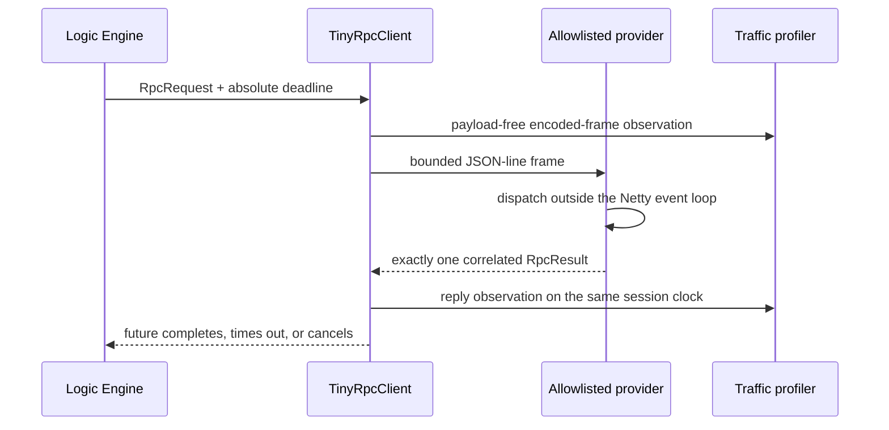

# Smart Home Communication

### A compact TinyRPC framework based on Netty

Smart Home Communication is the transport foundation for the Smart Home Edge Computing System. It provides a small, explicit RPC path for service-to-service calls: bounded JSON-line frames, allowlisted operations, correlated asynchronous responses, owned client/server lifecycles, and payload-free traffic observations.

The repository contains two generations. `tiny-rpc-*` is the current Spring-free runtime designed for the research system. `Consumer` and `Provider` preserve the earlier Spring proxy implementation as a compatibility reference; they are not used by the current core.

## Runtime flow



## Modules

| Module | Responsibility |
| --- | --- |
| `tiny-rpc-core` | JDK-only request/result types, limits, handlers, and allowlisted registry |
| `tiny-rpc-codec` | strict JSON-line framing with a 1 MiB default limit and local safe parser configuration |
| `tiny-rpc-netty` | bounded client/server transport, correlation, deadlines, cancellation, and lifecycle ownership |
| `tiny-rpc-telemetry` | payload-free frame observations for traffic profiling |
| `tiny-rpc-spring-adapter` | optional explicit Spring service registration |
| `examples` | real loopback invocation and instrumented trace output |
| `Consumer`, `Provider` | preserved legacy Spring demonstration |

## Design boundaries

- The provider executes only `(serviceId, operation)` pairs registered by the application. Request data cannot select a Java class or reflective method.
- Frame bytes, pending requests, queued writes, and provider work are bounded.
- Provider callbacks execute on a bounded dispatch pool, outside Netty event-loop threads.
- Timeout, cancellation, write failure, malformed input, peer disconnect, and owned shutdown clear correlation state.
- Telemetry records correlation IDs, direction, encoded frame length, and a session-relative monotonic offset. It contains no payload, arguments, result, credential, endpoint, or private path.
- The codec rejects unknown wrapper fields, special JSON keys, invalid result states, and unsupported protocol versions.

Authentication, encryption, discovery, retries, and circuit breaking remain outside this component. The SmartHome Logic Engine supplies local catalog resolution and the typed TinyRPC adapter.

## Java API

```java
TinyRpcServer server = TinyRpcServer.builder()
    .register("sensor.service", "read.state", argumentsJson -> resultJson)
    .build()
    .bind("127.0.0.1", 0);

try (TinyRpcClient client = TinyRpcClient.connect(
        "127.0.0.1", server.port(), RpcLimits.defaults(), telemetryListener)) {
    CompletableFuture<RpcResult> result = client.invoke(request);
}
```

Maven coordinates use version `0.0.1-SNAPSHOT`:

```xml
<dependency>
  <groupId>com.seclab</groupId>
  <artifactId>tiny-rpc-netty</artifactId>
  <version>0.0.1-SNAPSHOT</version>
</dependency>
```

## Verification

JDK 8 and Maven 3.6+ are required.

```bash
mvn --batch-mode --no-transfer-progress test
```

The suite exercises 2,000 sequential calls, 24 concurrent calls, reordered replies, pending/write/work limits, timeout/cancel/late-response cleanup, malformed and oversized frames, peer isolation, nested invocation responsiveness, repeated owned shutdown, strict JSON parsing, and telemetry observer failure.

The performance gate is frozen in [`benchmarks/acceptance-envelope-v2.json`](benchmarks/acceptance-envelope-v2.json). It compares 12 matched fresh-process runs against the untouched implementation with fixed JVM flags and a fixed-seed bootstrap. No footprint or latency improvement is claimed until the post-change measurements satisfy that predeclared gate. Core artifact size and complete runtime dependency closure are reported separately.

## Research provenance

This component is part of an independent smart-home edge-computing research system. The current bounded runtime is new engineering derived from the repository's earlier RPC experiments; preserved legacy modules are labelled explicitly so historical behavior is not presented as the current architecture.

## Rights

See [`RIGHTS.md`](RIGHTS.md). No open-source reuse license is granted for the owner's original contribution.
